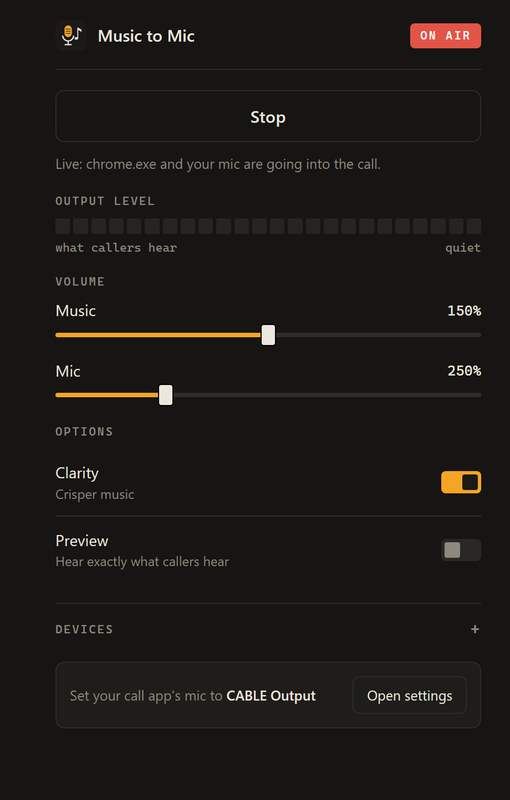

# Music to Mic

Play music from your browser (or any app) into a voice call, together with your mic, on Windows.
A simple alternative to Voicemeeter: one window, one Start button.

A quality-of-life project by **Mondcrest Automations**.

## What it does

- Captures the sound of **one app only** (e.g. Brave, Chrome, Spotify) using Windows per-app audio capture.
  Your call audio is never sent back, so callers don't hear an echo of themselves.
- Mixes it with your mic and sends both into a virtual cable. Your call app uses that cable as its mic.
- **Preview**: hear exactly what callers hear. While on, the app turns the music app's own speaker
  output down and boosts the capture to match, so you don't hear the music twice and callers hear no change.
- **Clarity**: an EQ that cuts boomy bass and lifts treble so music survives voice-call codecs better.
- Volume up to 300% (music) and 1000% (mic) with limiters, so loud doesn't mean distorted.
- Level meter showing what callers hear.

Works with any call app that lets you pick a microphone (WhatsApp Desktop, Discord, Zoom, Teams...).
Call apps still apply their own noise suppression, so music will never sound studio-perfect in a call.

## Requirements

- Windows 10 version 2004 or newer, or Windows 11
- Python 3.10+ ([python.org](https://www.python.org/downloads/))
- [VB-CABLE](https://vb-audio.com/Cable/) virtual audio driver (installed for you by `install.bat`)
- Microsoft Edge (comes with Windows; used to show the app window)

## Install

1. Download the zip from the
   [latest release](https://github.com/automations-mondcrest/music-to-mic/releases/latest) and unzip it
   somewhere permanent (e.g. `Documents\music-to-mic`).
2. Double-click **`install.bat`**. It:
   - installs the two Python packages it needs (`numpy`, `sounddevice`)
   - downloads the official VB-CABLE package from vb-audio.com, checks it is signed by VB-Audio,
     and installs it (click **Yes** on the one admin prompt)
   - hides the extra "CABLE In 16ch" device and keeps your normal speaker and mic as the defaults
   - puts a **Music to Mic** shortcut on your desktop

If VB-CABLE is already installed, that step is skipped. If the new devices don't show up, restart your PC.

Manual install instead: install [VB-CABLE](https://vb-audio.com/Cable/) yourself,
run `pip install -r requirements.txt`, then double-click `music_to_mic.pyw`.

### About VB-CABLE

VB-CABLE is made by **VB-Audio Software** ([vb-audio.com/Cable](https://vb-audio.com/Cable/), www.vb-cable.com).
It is **donationware**, not part of this project: if Music to Mic is useful to you, please support
VB-Audio with a donation or licence. Using it inside a company or organisation requires buying
VB-CABLE licences from [VB-Audio's shop](https://shop.vb-audio.com/). Music to Mic uses the official,
unmodified package, as VB-Audio's [distribution terms](https://vb-audio.com/Services/licensing.htm) allow.

## Use

1. Open the music app (e.g. your browser) first.
2. In Music to Mic, open **Devices** and check:
   - **Music from app**: your browser, e.g. `brave.exe`
   - **Your mic**: your real microphone
   - **Send to**: `CABLE Input (VB-Audio Virtual Cable)`
3. Press **Start**.
4. In your call app, set the microphone to **CABLE Output (VB-Audio Virtual Cable)**.
   The **Open settings** button opens the Windows volume mixer, where you can also set it per app.
5. Turn on **Preview**, play music, and set the two sliders until the level meter shows "good".
   Then turn Preview off.

To avoid echo, keep your call app's speaker on your headphones (never on CABLE Input),
and never pick CABLE Output as "Your mic" in Music to Mic.

## Troubleshooting

- **"is not running"**: open the music app before pressing Start. If you restart the browser, press Stop and Start.
- **Callers hear nothing**: check the call app's mic is CABLE Output and that the level meter moves.
- **Music sounds muffled in the call**: keep Clarity on, and turn off *Audio enhancements* for CABLE Output
  in Windows Sound settings. The rest is the call app's own processing.
- **Extra "CABLE In 16ch" device**: VB-Cable adds it. You can disable it in Control Panel > Sound > Playback.

## How it works

- `music_to_mic.pyw`: per-process loopback capture (`ActivateAudioInterfaceAsync` with
  `VAD\Process_Loopback`) via ctypes, mixing/EQ/limiting with numpy, audio I/O with sounddevice (WASAPI),
  and a small localhost-only web server (random token) for the window.
- `sessions.py`: reads and sets the music app's Windows audio-session volume for Preview.
- `ui.html`: the window, shown in an Edge app window.
- `make_icon.py`: regenerates `icon.ico` and `icon.svg` (needs `pillow`).
- `setup_cable.py`: downloads, verifies and installs VB-CABLE, then restores your default devices.
- `test_dsp.py`: self-check for the limiter, buffer and EQ maths, no sound devices needed: `python test_dsp.py`.

Privacy: nothing leaves your PC. The window talks to the app over `127.0.0.1` only, with a random
per-launch token, and the app itself makes no internet requests (only `setup_cable.py` contacts vb-audio.com, once).

Contributions welcome: open an issue or a pull request.

## License

MIT, Copyright (c) 2026 Mondcrest Automations. See [LICENSE](LICENSE).
VB-Audio Virtual Cable is a separate product by VB-Audio Software with its own licence.
